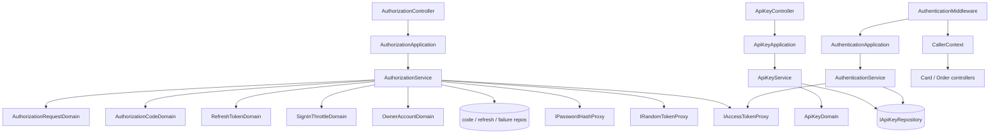

# Owner Sign-in & Member Keys (backend v2) — Architecture Design

**Status:** Confirmed (unattended run)
**Source PRD:** `.sdd/2026-11-25-auth/PRD.md`
**Tech context:** Go 1.26 · Gin · GORM + pgx (PostgreSQL) · golang-jwt · `golang.org/x/crypto/bcrypt` ·
testify + uber-go/mock · Clean/Onion layers as in v1 (`.sdd/2026-11-25-trading-board/ARCH.md`).

---

## 1. Design Goal & Guiding Principle

- **In one sentence:** make the board its own OAuth 2.0 authorization server for one public client
  (Authorization Code + PKCE S256, short-lived JWT access token, rotating hashed refresh tokens in an
  HttpOnly cookie, RFC 7009 revocation) and replace the static agent key with owner-managed, hashed,
  per-member API keys whose member name is carried into every write as attribution.
- **Guiding principle:** *every credential is a Domain Model that judges itself; services only fetch,
  ask and store.* `AuthorizationCodeDomain` redeems itself against a token request,
  `RefreshTokenDomain` says whether it is current / reused / expired, `ApiKeyDomain` says whether it
  admits and whether its last-used time is stale, `SignInThrottleDomain` says whether sign-in is locked,
  and `OwnerAccountDomain` matches the email. The OAuth wire format (`{error, error_description}`,
  form-encoded token requests, the cookie) stays in the controller; the domain speaks in DTOs and
  `BusinessError`s. A new grant type or credential kind is a new Domain Model plus one service method.

All auth writes (sign-in, code exchange, refresh, revoke, key create/revoke) run inside the existing
`ITransactionRepository.Exclusively` (ledger-wide advisory-lock transaction). Single user, so the
serialization is free, and it makes "consume once", "rotate once" and "unique active member name"
race-free without extra locking code.

---

## 2. Change Scope

| Area | Action | What / Why |
| :--- | :--- | :--- |
| `internal/config` | **Modify** | Drop `OWNER_USERNAME/OWNER_PASSWORD/AGENT_API_KEY`; add `OWNER_EMAIL`, `OWNER_PASSWORD_HASH`, `OAUTH_CLIENT_ID`, `OAUTH_REDIRECT_URIS`, `AUTH_ACCESS_TOKEN_LIFETIME_MINUTES` (15), `AUTH_REFRESH_TOKEN_LIFETIME_DAYS` (30), `AUTH_AUTHORIZATION_CODE_LIFETIME_SECONDS` (60), `AUTH_REFRESH_COOKIE_DOMAIN`, `AUTH_REFRESH_COOKIE_SECURE`. |
| `internal/domain` | **Add/Modify** | Entities `AuthorizationCode`, `RefreshToken`, `ApiKey`, `SignInFailure`; domain models listed in §3; attribution columns on `TradeCard`, `TradeOrder`, `OrderFill`. |
| `internal/application` | **Add/Modify** | `AuthorizationApplication` (authorize / token / revoke), `ApiKeyApplication`; `AuthenticationApplication` gains `CurrentOwner`; card/order applications pass attribution. |
| `internal/controller` | **Add/Modify** | `AuthorizationController` (OAuth wire format + cookie + Origin check), `ApiKeyController`, `/me`; middleware `RequireOwner`, caller stored on the request; CORS with credentials; remove `POST /auth/login`. |
| `internal/infrastructure` | **Add** | GORM repositories for the four new entities; `BcryptPasswordHashProxy`; `CryptoRandomTokenProxy`. |
| `cmd/hash-password` | **Add** | Reads a password from stdin and prints its bcrypt hash for `OWNER_PASSWORD_HASH`. |
| Trade ledger, budget, fee, position logic | **Not touched** | Attribution is a stored label; no business rule of v1 depends on it. |
| JWT format / signing | **Not touched** | Same HS256 proxy; only the lifetime changes. Access tokens stay stateless (logout does not revoke them — PRD accepts this). |

---

## 3. New Classes / Modules

| Name | Kind | Responsibility (purpose) | Collaborators | Satisfies |
| :--- | :--- | :--- | :--- | :--- |
| `OwnerAccountDomain` | Domain model | Normalises and matches the owner email; holds the password hash; "not configured" admits nobody | `OwnerAccountVo` | US-01, US-07 |
| `SignInThrottleDomain` | Domain model | From the latest failures says whether sign-in is locked at `now` (5 within 15 min → locked 15 min after the 5th) | `SignInThrottlePolicyVo` | US-02 |
| `AuthorizationRequestDomain` | Domain model | Validates client id, redirect URI (exact match against allow-list), `response_type=code`, PKCE method S256 and challenge shape; issues the code entity and the redirect target | `OAuthClientVo` | US-03 |
| `AuthorizationCodeDomain` | Domain model | Redeems a code: not consumed, not expired, same client, same redirect URI, `BASE64URL(SHA256(verifier)) == challenge` | — | US-04 |
| `RefreshTokenDomain` | Domain model | Classifies a presented refresh token: current / rotated (reuse) / revoked / expired; produces the successor entity | — | US-05, US-06 |
| `ApiKeyDomain` | Domain model | New-key validation (member name 1–40 runes trimmed, note ≤ 200), admits when active, last-used staleness (≥ 1 min), revoke, DTO shape | — | US-08, US-09, US-10 |
| `OpaqueSecretDomain` | Domain model | A high-entropy secret: SHA-256 hex digest for storage/lookup, display prefix | — | US-04, US-05, US-08 |
| `AuthorizationService` | Domain service | Authorize (throttle + password + request → code), ExchangeCode, Refresh (rotation + family revocation on reuse), Revoke | code/refresh/failure repositories, `IPasswordHashProxy`, `IRandomTokenProxy`, `IAccessTokenProxy`, `IClockProxy`, `ITransactionRepository` | US-01…US-06 |
| `ApiKeyService` | Domain service | Create (unique active member name), List, Revoke | `IApiKeyRepository`, `IRandomTokenProxy`, `IClockProxy`, `ITransactionRepository` | US-08, US-09 |
| `IAuthorizationCodeRepository`, `IRefreshTokenRepository`, `IApiKeyRepository`, `ISignInFailureRepository` | Interfaces | Persistence of the new entities (one entity, one repository) | — | all |
| `IPasswordHashProxy` / `BcryptPasswordHashProxy` | Interface / proxy | `Matches(hash, password)`; an empty or malformed hash matches nothing | bcrypt | US-01 |
| `IRandomTokenProxy` / `CryptoRandomTokenProxy` | Interface / proxy | `NewToken()` = 32 bytes from `crypto/rand`, base64url without padding | crypto/rand | US-04, US-05, US-08 |
| `AuthorizationController` | Controller | `POST /api/v1/oauth/authorize` (JSON), `POST /api/v1/oauth/token` (form), `POST /api/v1/oauth/revoke` (form); refresh cookie; Origin allow-list for cookie-using requests; OAuth error body; `Cache-Control: no-store` | `AuthorizationApplication`, `ErrorPresenter` | US-01…US-06 |
| `ApiKeyController` | Controller | `GET/POST /api/v1/api-keys`, `POST /api/v1/api-keys/:id/revoke` | `ApiKeyApplication` | US-08, US-09 |
| `CallerContext` | Controller helper object | Stores the identified `CallerDto` on the request and reads it back for attribution | gin | US-10 |

Token response: `{access_token, token_type:"Bearer", expires_in}`; the refresh token is set only as the
cookie `trading_board_refresh_token` (HttpOnly, Secure per config, SameSite=Strict, Path=`/api/v1/oauth`,
Domain per config, Max-Age = refresh lifetime). Error mapping on OAuth endpoints:

| Situation | Status | `error` |
| :--- | :--- | :--- |
| Wrong email/password | 401 | `access_denied` |
| Locked | 429 | `temporarily_unavailable` |
| Unknown client | 400 | `invalid_client` |
| Bad redirect URI, response type, PKCE, missing fields | 400 | `invalid_request` |
| Bad / expired / reused code or refresh token | 400 | `invalid_grant` |
| Unknown grant type | 400 | `unsupported_grant_type` |
| Cookie request from a disallowed or missing Origin | 403 | `invalid_request` |

`authorize` answers `{redirectTo}`; `revoke` answers 200 with an empty body and clears the cookie.
Non-OAuth endpoints keep `{error:{code,message}}`; a member key on an owner-only route → 403
`forbidden`.

---

## 4. Modified Components

| Component | Current role | Change needed |
| :--- | :--- | :--- |
| `AuthenticationService` | SignIn + IdentifyCaller with static creds | Drop SignIn; IdentifyCaller looks up the API key digest (active → `CallerDto{Role: agent, Name: member}`, touching last-used when stale), else verifies the bearer (`{Role: owner, Name: "owner"}`); add `CurrentOwner()` → `OwnerDto{email}` |
| `AccessCredentialDomain/Vo` | username/password/agent key | Replaced by `OwnerAccountDomain/Vo` |
| `AuthenticationMiddleware` | RequireOwnerOrAgent, RequireAgent | Stores caller via `CallerContext`; adds `RequireOwner` |
| `CorsMiddleware` | origin allow-list | `Access-Control-Allow-Credentials: true`, allow `DELETE` not needed; keep headers |
| `ErrorPresenter` | v1 error body | New kinds `ErrForbidden` (403) and `ErrTooManyAttempts` (429); `RespondOAuth` renders `{error, error_description}` from `OAuthError` |
| `TradeCard`, `TradeOrder`, `OrderFill` entities + DTOs | — | `PublishedBy`, `SkippedBy`, `ReportedBy` (`not null default ''`); DTO fields `publishedBy`, `skippedBy`, `reportedBy` |
| `TradeCardService.PublishCard`, `TradeOrderService.ReportFill/SkipOrder` | — | Receive the actor (in the publish/report DTO; skip takes `OrderSkipDto`) and store it |
| `SchemaMigrator` | 3 entities | + 4 new entities |
| Router | `/auth/login` | Removed; new routes above |

---

## 5. Component Relationships

---

## 6. Extensibility & Handoff Notes

- **Most likely next requirement:** API key scopes or expiry; a second user; MFA.
- **Where it lands:** `ApiKeyDomain.Admits(now)` (expiry) and `CallerDto` (add scopes, checked by a
  new middleware method); `OwnerAccountDomain` becomes an `Account` entity + repository for a second
  user — `AuthorizationService` only asks "does this account match?".
- **How to add it:** a new grant type is a new `case` in `AuthorizationController.Token` plus a new
  service method reusing the shared `issueTokens` helper; a new credential kind is one Domain Model +
  one repository.
- **Patterns applied & why:** self-judging Domain Models for each credential; OAuth wire format kept in
  the controller so the domain stays protocol-agnostic.
- **Do not hardcode:** lifetimes, client id, redirect URIs, cookie domain/secure — all config.
- **Known debt / deferred:** expired codes and refresh tokens are never purged (tiny volume; add a
  cleanup job under `job/` if tables grow); discovery document not implemented (optional); access
  tokens cannot be revoked before expiry.

---

## 7. Traceability

| PRD Scenario | Fulfilled by |
| :--- | :--- |
| US-01 right email/password (case/space-insensitive) | `OwnerAccountDomain.Matches` + `IPasswordHashProxy` + `AuthorizationService.Authorize` |
| US-01 wrong password / unknown email (same words) / owner not set | `AuthorizationService.Authorize` (always runs the hash check) + `OwnerAccountDomain` |
| US-02 fifth failure locks; right password refused while locked; lock ends at 15 min; spread failures; success clears | `SignInThrottleDomain` + `ISignInFailureRepository` (Record / ListLatest / Clear) |
| US-03 registered app; unknown app; disallowed return address; weak/missing proof | `AuthorizationRequestDomain` |
| US-04 fresh code; > 60 s; reused; wrong secret uses it up; different return address | `AuthorizationCodeDomain.Redeem` + `AuthorizationService.ExchangeCode` (consume before judging) |
| US-05 rotation; reuse ends family; 29d23h ok; 30d expired; other website; no cookie | `RefreshTokenDomain` + `AuthorizationService.Refresh` + `AuthorizationController` Origin check |
| US-06 sign-out ends family; unknown/none answered done; other website refused | `AuthorizationService.Revoke` + `AuthorizationController` Origin check |
| US-07 who am I; member key refused | `AuthenticationService.CurrentOwner` + `RequireOwner` |
| US-08 create shown once with `tbk_`; 40 ok; 41/blank refused; duplicate active (case) refused; revoked name reusable; member key refused | `ApiKeyDomain` + `ApiKeyService.Create` + `RequireOwner` |
| US-09 newest first; revoke stops at once; revoke twice unchanged; unknown not found; member key refused | `ApiKeyService.List/Revoke` + `ApiKeyDomain` + `AuthenticationService.IdentifyCaller` |
| US-10 publisher / reporter / skipper recorded; owner cannot publish; revoked key refused; last-used once per minute | `CallerContext` + card/order services + `RequireAgent` + `ApiKeyDomain.NeedsLastUsedRefresh` |

---

## 8. Risks & Open Decisions

- **Risks / trade-offs:** global advisory lock also serialises sign-ins (bcrypt ≈ 50–100 ms) — fine
  for one user; parallel refreshes with the same cookie (two tabs) are treated as reuse and end the
  session — the frontend must funnel refreshes through one in-flight promise.
- **Open decisions (for implementation):** none.
