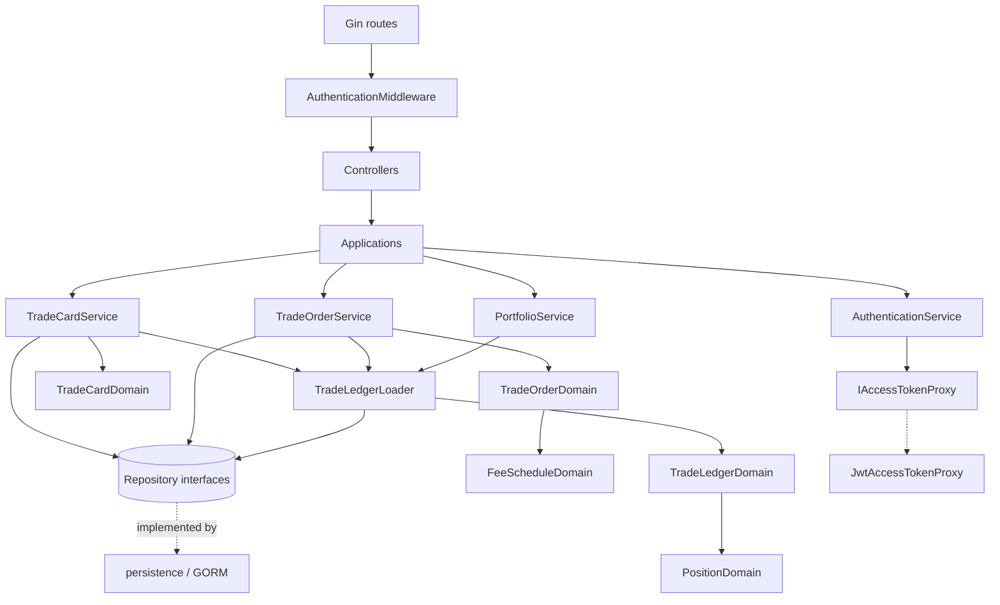

# Trading Board (backend v1) — Architecture Design

**Status:** Confirmed (unattended run)
**Source PRD:** `.sdd/2026-11-25-trading-board/PRD.md`
**Tech context:** Go 1.26 · Gin · GORM + pgx (PostgreSQL) · shopspring/decimal · golang-jwt ·
testify + uber-go/mock · Clean/Onion layers mirroring go-trading
(`cmd/{server,migrate}`, `internal/{config,controller,application,domain,infrastructure}`).

---

## 1. Design Goal & Guiding Principle

- **In one sentence:** store exactly two things — published cards (with their orders) and
  the append-only fill log — and serve the shared contract §4 by deriving holdings, budget and
  performance from that log on every request.
- **Guiding principle:** *one deep module owns all derived money.* `TradeLedgerDomain` is
  built from the ordered fill log and answers every derived question (held shares, open /
  closed positions, month summary, "may this fill be admitted?"). Nothing derived is stored,
  so no derived figure can drift, and the likely next requirements (correcting a fill,
  unrealized P&L) are additions to one place instead of migrations of cached state.

Write serialization: every write use case (publish, report fill, skip) runs inside
`ITransactionRepository.Exclusively`, a transaction holding a ledger-wide PostgreSQL
transaction-scoped advisory lock — single user, so serializing writes is free and makes the
cross-row rules (no oversell, no overspend, no replace-after-fill) race-free.

---

## 2. Change Scope

Greenfield service in `backend/`; nothing existing in this repo is modified except docs.

| Area | Action | What / Why |
| :--- | :--- | :--- |
| `backend/go.mod`, `cmd/server`, `cmd/migrate` | **Add** | Composition root; migrate-then-serve like go-trading (one image, two binaries). |
| `internal/config` | **Add** | Env-driven settings (DB, credentials, fees, budget, time zone, CORS). |
| `internal/domain` | **Add** | Entities, domain models (card, order, fee schedule, ledger, position, calendar, credentials), DTO/VO, services, interfaces + mocks. |
| `internal/application` | **Add** | One thin application per use-case group. |
| `internal/controller` | **Add** | Gin handlers, request models, auth middleware, CORS, error presenter. |
| `internal/infrastructure` | **Add** | GORM repositories, schema migrator, transaction repository, JWT proxy, system clock. |
| `Dockerfile`, `Makefile`, `.env.example`, `.dockerignore` | **Add** | Mirror go-trading. |
| `/.github/workflows/backend-ci.yml` | **Add** | Test → build → push GHCR → bump deploy tag. |
| `go-trading-deploy/trading-board-backend/` | **Add** | k8s manifests + Argo Application + DB creation doc. |
| `frontend/**` | **Not touched** | Owned by the other agent. |
| Background jobs | **Not added** | PRD: expired orders are a display concern; no job needed. |
| Stored positions / monthly aggregates | **Not added** | Derived on read (see principle). |

---

## 3. New Classes / Modules

### Domain models (`internal/domain/models`)

| Name | Kind | Responsibility (purpose) | Collaborators | Satisfies |
| :--- | :--- | :--- | :--- | :--- |
| `entities.TradeCard` | Entity | Card row: id, tradeDate (unique, `YYYY-MM-DD`), status, note, publishedAt; has many orders (cascade). | — | US-02, US-03 |
| `entities.TradeOrder` | Entity | Order row for both sides (`side`, `sequence`, buy-only and sell-only columns nullable), `isSkipped`; has many fills. | — | US-02, US-04 |
| `entities.OrderFill` | Entity | Append-only fill: price, shares, fee, amount, filledAt, recordedAt; belongs to order. `ToLedgerEntryVo()` shape conversion. | — | US-04..06 |
| `domains.TradeCardDomain` | Domain model | Two constructors: `NewPublishedTradeCardDomain(publishDto, publishedAt)` validates every card rule (status vs orders, price ordering, shares, chase price) and yields `ToEntity()`; `NewTradeCardDomain(entity)` yields `ToDto()`, `ToSummaryDto()`, `HasFills()`, `SoldSharesBySymbol()`. | `TradeOrderDomain` | US-02, US-03 |
| `domains.TradeOrderDomain` | Domain model | Order progress: `Status()` derived (skipped / filled / partiallyFilled / pending), `ReportFill(fillDto, feeSchedule, recordedAt)` → new fill entity (rejects skipped → conflict, overfill → validation, estimates fee), `Skip()` (filled → conflict), `ToDto()`, `ToLedgerEntryVo(fill)`. | `FeeScheduleDomain` | US-04 |
| `domains.FeeScheduleDomain` | Domain model | Broker fee + sell tax estimate with rounding and minimum; built from `vo.FeeScheduleVo` config. | — | US-04 fee scenarios |
| `domains.TradeLedgerDomain` | Domain model (deep) | Built from ordered `[]vo.LedgerEntryVo` + earliest card date + `BudgetPolicyVo` + today. Replays fills into positions and per-month books. Public: `HeldShares(symbol)`, `Positions(filter)`, `MonthSummary(month)`, `Admit(entry)` (oversell → conflict; any month from the entry's month onward going negative → conflict). | `PositionDomain`, `BusinessCalendarDomain` | US-02 sell checks, US-04 conflicts, US-05, US-06 |
| `domains.PositionDomain` | Domain model | One holding lifecycle: buy at average cost, sell with cost-of-sold rounding (closing sale takes all), win/loss, days held, latest stop/take-profit. | — | US-05 |
| `domains.BusinessCalendarDomain` | Domain model | Taipei calendar: date / month of an instant, today, month arithmetic, budget mode for a month. | — | US-05 days held, US-06 mode |
| `domains.AccessCredentialDomain` | Domain model | Owner username/password and agent key; constant-time `AdmitsOwner`, `AdmitsAgent`; refuses when unset. | — | US-01 |
| `domains` errors | Errors | Sentinels `ErrValidation`, `ErrNotFound`, `ErrConflict`, `ErrAuthenticationRequired` + `BusinessError{code, message}` wrapping one of them; the code is the contract `error.code`. | — | all error scenarios |
| `dto.*` | DTO | `TradeCardPublishDto` (+ buy/sell order write DTOs), `TradeCardDto`, `BuyOrderDto`, `SellOrderDto`, `OrderFillDto`, `TradeCardSummaryDto`, `OrderFillReportDto`, `PositionDto`, `PositionQueryDto`, `MonthSummaryDto`, `SignInDto`, `AccessTokenDto`, `CallerCredentialDto`, `CallerDto`, `OrderDto` (either side). JSON tags = contract names; decimals marshal as strings. | — | contract §4 |
| `vo.*` | VO | `LedgerEntryVo`, `FeeScheduleVo`, `BudgetPolicyVo`, `AccessTokenClaimsVo`, `AccessTokenVo`, enum string types (`OrderSideVo`, `OrderStatusVo`, `CardStatusVo`, `ExitReasonVo`, `BudgetModeVo`, `PositionStatusVo`, `CallerRoleVo`). | — | — |

### Domain services (`internal/domain/service`)

| Name | Responsibility | Collaborators | Satisfies |
| :--- | :--- | :--- | :--- |
| `AuthenticationService` | `SignIn` (credentials → token with expiry), `IdentifyCaller` (api key → agent; valid bearer → owner; else unauthenticated). | `AccessCredentialDomain`, `IAccessTokenProxy`, `IClockProxy` | US-01 |
| `TradeCardService` | `PublishCard` (validate, exclusively: refuse replace when filled, check sells vs ledger, delete + create), `GetCard`, `GetLatestCard`, `ListCards(month)`. | `ITradeCardRepository`, `ITransactionRepository`, `TradeLedgerLoader` | US-02, US-03 |
| `TradeOrderService` | `ReportFill`, `SkipOrder` — exclusively: load order, apply order rule, admit into ledger, persist. | `ITradeOrderRepository`, `IOrderFillRepository`, `ITransactionRepository`, `TradeLedgerLoader`, `FeeScheduleDomain` | US-04, US-06 overspend |
| `PortfolioService` | `ListPositions(query)`, `GetMonthSummary(month)`. | `TradeLedgerLoader` | US-05, US-06 |
| `TradeLedgerLoader` | Loads fill log + earliest card date + today and builds `TradeLedgerDomain` (one place, used by three services). | `IOrderFillRepository`, `ITradeCardRepository`, `IClockProxy`, `BusinessCalendarDomain`, `BudgetPolicyVo` | — |

### Interfaces (`internal/domain/interface`, one per file, mockgen mocks in `mocks/`)

`ITradeCardRepository` (FindByTradeDate, FindLatest, ListByMonth, FindEarliestTradeDate,
Create, Delete), `ITradeOrderRepository` (FindByID, MarkSkipped), `IOrderFillRepository`
(Create, ListInRecordedOrder), `ITransactionRepository` (Exclusively), `IClockProxy` (Now),
`IAccessTokenProxy` (Issue, Verify).

### Application / controller / infrastructure

| Name | Responsibility |
| :--- | :--- |
| `AuthenticationApplication`, `TradeCardApplication`, `TradeOrderApplication`, `PortfolioApplication` | Pass-through use cases returning DTOs. |
| `AuthenticationController`, `TradeCardController`, `TradeOrderController`, `PortfolioController`, `HealthController` | Bind requests / query params, call application, write DTO or error. |
| `middlewares.AuthenticationMiddleware` | `RequireOwnerOrAgent`, `RequireAgent` → 401 with contract error body. |
| `middlewares.CorsMiddleware` | Allow configured origins; headers Authorization, X-Api-Key, Content-Type. |
| `controller.ErrorPresenter` | Maps `BusinessError` sentinel → 400/401/404/409, writes `{error:{code,message}}`; unknown → 500 `internalError`. |
| `models.*Request` | `SignInRequest`, `TradeCardRequest` (+ order requests), `OrderFillRequest` with `ToXxxDto()`. |
| `persistence.TradeCardRepository`, `TradeOrderRepository`, `OrderFillRepository` | GORM, joining ambient transaction. |
| `persistence.TransactionRepository` | `Exclusively`: transaction + `pg_advisory_xact_lock(?)` (parameterized; the documented exception, as in go-trading's migrator). |
| `persistence.SchemaMigrator` | `AutoMigrate` of the three entities under a session advisory lock. |
| `security.JwtAccessTokenProxy` | HS256 issue / verify, expiry required. |
| `clock.SystemClockProxy` | `time.Now()`. |

---

## 4. Modified Components

None (greenfield). Repo docs only: `docs/contract-change-requests/backend.md` (new).

---

## 5. Component Relationships

---

## 6. Extensibility & Handoff Notes

- **Most likely next requirement:** correcting / deleting a mistyped fill; then unrealized
  P&L once a price feed exists.
- **Where it lands:** correction = `IOrderFillRepository` gains `Delete/Update`, the use case
  re-runs `TradeLedgerDomain.Admit`-style validation on the ledger without that fill —
  nothing derived needs recomputing because nothing derived is stored. Unrealized P&L =
  new `IQuoteProxy` (+ `XxxQuoteProxy` impl) and `PositionDomain` gains a mark-to-price
  projection; `PortfolioService` passes quotes in.
- **How to add it:** add-only — new interface + proxy, new ledger/position methods; no
  migration of cached figures.
- **Patterns applied & why:** event-sourcing-lite (fill log is the source of truth, ledger
  is a replayed projection) — chosen because every v1 figure is a fold over fills and the
  next requirements mutate the log.
- **Do not hardcode:** fee rate, discount, minimum fee, tax rate, allocation, month-end day,
  time zone, token lifetime — all in `config` → VOs.
- **Known debt / deferred:** full replay on every request is O(fills); fine for one owner
  (≈ a few thousand fills/year). Revisit with a snapshot table only if reads exceed ~100 ms.

---

## 7. Traceability

| PRD Scenario | Fulfilled by |
| :--- | :--- |
| US-01 owner signs in with correct credentials | `AuthenticationService.SignIn` + `AccessCredentialDomain` + `JwtAccessTokenProxy` |
| US-01 owner signs in with a wrong password | `AccessCredentialDomain.AdmitsOwner` → `ErrAuthenticationRequired` |
| US-01 reading without a pass or key is refused | `AuthenticationMiddleware` + `AuthenticationService.IdentifyCaller` |
| US-01 an expired pass is refused | `JwtAccessTokenProxy.Verify` (expiry) → middleware 401 |
| US-01 the agent team may read with its key | `AccessCredentialDomain.AdmitsAgent` + `RequireOwnerOrAgent` |
| US-01 the owner cannot publish a card | `RequireAgent` |
| US-02 a well-formed buy order is accepted | `TradeCardDomain` (published) + `TradeCardService.PublishCard` |
| US-02 limit equal to the highest chase price is accepted | `TradeCardDomain` validation |
| US-02 stop-loss equal to the limit is refused | `TradeCardDomain` validation |
| US-02 take-profit equal to the limit is refused | `TradeCardDomain` validation |
| US-02 limit above the highest chase price is refused | `TradeCardDomain` validation |
| US-02 a single odd-lot share is accepted | `TradeCardDomain` validation |
| US-02 zero shares or a zero price is refused | `TradeCardDomain` validation |
| US-02 selling what is held is accepted | `TradeCardService` + `TradeLedgerDomain.HeldShares` |
| US-02 selling one share more than held is refused | `TradeCardDomain.SoldSharesBySymbol` vs `TradeLedgerDomain.HeldShares` |
| US-02 selling a stock not held is refused | same |
| US-02 two sell orders of one stock together exceeding the holding are refused | same (summed per symbol) |
| US-02 a no-trade card is accepted | `TradeCardDomain` |
| US-02 a no-trade card carrying an order is refused | `TradeCardDomain` |
| US-02 a trade card with no orders is refused | `TradeCardDomain` |
| US-02 re-publishing replaces a card with no fills | `TradeCardService.PublishCard` (Delete + Create in `Exclusively`) |
| US-02 re-publishing replaces a card whose only change is a skipped order | `TradeCardDomain.HasFills` |
| US-02 re-publishing a card with a fill is refused | `TradeCardDomain.HasFills` → `ErrConflict` |
| US-03 latest card is the one with the greatest session date | `ITradeCardRepository.FindLatest` + `TradeCardDomain.ToDto` |
| US-03 no card yet | `TradeCardService.GetLatestCard` → `ErrNotFound` |
| US-03 a card of a date without one | `TradeCardService.GetCard` → `ErrNotFound` |
| US-03 listing a month newest first | `ListByMonth` + `TradeCardDomain.ToSummaryDto` |
| US-04 a full fill completes the order | `TradeOrderDomain.ReportFill` / `Status` |
| US-04 a partial fill | `TradeOrderDomain.Status` |
| US-04 the last shares complete the order | `TradeOrderDomain.Status` |
| US-04 overfilling is refused | `TradeOrderDomain.ReportFill` → `ErrValidation` |
| US-04 a skipped order takes no fills | `TradeOrderDomain.ReportFill` → `ErrConflict` |
| US-04 skipping a waiting order | `TradeOrderDomain.Skip` + `MarkSkipped` |
| US-04 skipping a partly filled order keeps what filled | `TradeOrderDomain.Skip` + `TradeLedgerDomain` (fills untouched) |
| US-04 a fully filled order cannot be skipped | `TradeOrderDomain.Skip` → `ErrConflict` |
| US-04 an unknown order | `TradeOrderService` → `ErrNotFound` |
| US-04 buy fee estimated when left out | `FeeScheduleDomain` |
| US-04 minimum fee applies to a tiny buy | `FeeScheduleDomain` |
| US-04 sell fee includes transaction tax | `FeeScheduleDomain` |
| US-04 a given fee is kept | `TradeOrderDomain.ReportFill` |
| US-05 first buy opens a holding | `PositionDomain` via `TradeLedgerDomain.Positions` |
| US-05 a second buy averages the cost | `PositionDomain` |
| US-05 a partial sale realizes profit at average cost | `PositionDomain` |
| US-05 selling the rest closes the holding as a win | `PositionDomain` |
| US-05 a closed holding with no profit is a loss | `PositionDomain` |
| US-05 selling more than held is refused | `TradeLedgerDomain.Admit` → `ErrConflict` |
| US-05 buying again after closing opens a new holding | `TradeLedgerDomain` replay |
| US-05 open holding details | `PositionDomain` + `BusinessCalendarDomain` |
| US-05 closed holdings of a month | `TradeLedgerDomain.Positions(filter)` |
| US-06 first month budget | `TradeLedgerDomain.MonthSummary` |
| US-06 unspent money rolls over | `TradeLedgerDomain.MonthSummary` |
| US-06 sale proceeds are recycled | `TradeLedgerDomain.MonthSummary` |
| US-06 a buy that uses exactly the remaining money is accepted | `TradeLedgerDomain.Admit` |
| US-06 a buy that would overspend is refused | `TradeLedgerDomain.Admit` → `ErrConflict` |
| US-06 a month before the first one does not exist | `TradeLedgerDomain.MonthSummary` → `ErrNotFound` |
| US-06 strict on the 21st | `BusinessCalendarDomain` mode |
| US-06 month-end from the 22nd | `BusinessCalendarDomain` mode |
| US-06 monthly performance | `TradeLedgerDomain.MonthSummary` |
| US-06 a month with nothing sold | `TradeLedgerDomain.MonthSummary` |
| US-07 alive check | `HealthController` (`GET /health`, `GET /api/v1/health`, no auth) |

---

## 8. Risks & Open Decisions

- **Risks / trade-offs:** advisory lock is one hand-written parameterized statement (same
  exception go-trading documents for its migrator; GORM has no API). Full replay per request
  accepted for single-tenant scale.
- **Contract details decided here (to propose to the coordinator):**
  - Position object: `symbol, name, status, shares, averageCost, totalCost, stopLossPrice,
    takeProfitPrice, openedDate, closedDate, daysHeld, realizedPnl, result` (closed-only
    fields null on open and vice versa; `result` = `win`/`loss`).
  - Month summary: flat object `month, mode, allocation, carriedOver, recycledProceeds,
    spent, remaining, realizedPnl, closedPositionCount, winCount, lossCount, winRate,
    realizedReturnPct` (percentages as decimal strings, 2 dp).
  - Order objects additionally carry `side` (`buy`/`sell`) so fill/skip responses are
    self-describing; error codes listed in the change-request doc.
  - List endpoints return bare JSON arrays.
- **Open decisions (for implementation):** none blocking.
