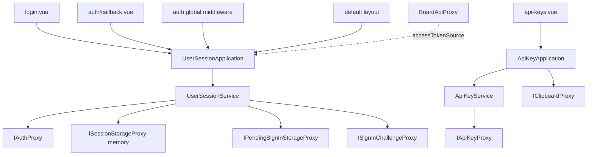

# Owner Sign-in & Member Keys (web v2) — Architecture Design

**Status:** Confirmed (unattended run)
**Source PRD:** `.sdd/2026-11-25-auth/PRD.md`
**Tech context:** Nuxt 3 SPA (`ssr: false`) · TypeScript strict · Clean/Onion per `frontend/.claude/rules` ·
Vitest + @vue/test-utils · backend contract: `backend/.sdd/2026-11-25-auth/ARCH.md` (OAuth endpoints, cookie, errors).

---

## 1. Design Goal & Guiding Principle

- **In one sentence:** replace username + stored token with the board's OAuth 2.0 Authorization Code +
  PKCE flow — access token in page memory only, refresh token in the board's HttpOnly cookie, silent
  renewal on start-up and on demand — and add a 「API 金鑰」 screen over the board's key endpoints.
- **Guiding principle:** *one module owns "do I have a usable access token?".* `UserSessionService`
  hands every request its token through a single `accessToken()` that renews when less than a minute is
  left, sharing one in-flight renewal (a second concurrent renewal would be treated by the board as
  refresh-token reuse and end the session). `BoardApiProxy` no longer reads storage: the composition
  root gives it an access-token source and the existing "signed out" callback, so every resource proxy
  gets renewal for free and none knows how it works.

---

## 2. Change Scope

| Area | Action | What / Why |
| :--- | :--- | :--- |
| `domain/interface/i-auth-proxy.ts` | **Modify** | `authorize`, `exchangeCode`, `refresh`, `revoke`, `fetchCurrentOwner` (one proxy for the board's `oauth/*` + `me`) |
| `domain/interface/i-session-storage-proxy.ts` | **Keep** | same contract; implementation becomes page memory (`MemorySessionStorageProxy`) instead of `localStorage` |
| `domain/interface/i-sign-in-challenge-proxy.ts` | **Add** | draws `code_verifier` + `state` and derives the S256 `code_challenge` (Web Crypto) |
| `domain/interface/i-pending-sign-in-storage-proxy.ts` | **Add** | keeps verifier + state across the redirect (`sessionStorage`, this tab only), `take()` removes it |
| `domain/interface/i-api-key-proxy.ts`, `i-clipboard-proxy.ts` | **Add** | key list/create/revoke; copy to clipboard |
| `domain/service/user-session-service.ts` | **Modify** | `beginSignIn`, `completeSignIn`, `restoreSession`, `accessToken`, `signOut`, `fetchCurrentOwner` |
| `domain/service/api-key-service.ts` | **Add** | list / create / revoke keys |
| `domain/models/domains/session-domain.ts` | **Modify** | `needsRenewalAt(now)` (< 60 s left or empty) |
| `domain/models/domains/api-key-domain.ts` | **Add** | status label + tone, last-used text (「從未使用」), created text, `canRevoke` |
| `domain/models/domains/trade-card-domain.ts` | **Modify** | `publisherText` (「發布者：x」 or empty) |
| `domain/errors/` | **Add/Modify** | `CredentialsRejectedError` → 「電子郵件或密碼錯誤」; new `SignInLockedError`, `SignInFlowExpiredError` |
| `infrastructure/proxy/board-api-proxy.ts` | **Modify** | token from injected async source; `withCredentials` + form bodies for OAuth; reads OAuth `{error, error_description}`; 429 → `SignInLockedError` |
| `infrastructure/proxy/*` | **Add** | `AuthProxy` (rewritten), `MemorySessionStorageProxy`, `BrowserPendingSignInStorageProxy`, `WebCryptoSignInChallengeProxy`, `ApiKeyProxy`, `BrowserClipboardProxy`; remove `SessionStorageProxy` (localStorage) |
| `application/` | **Modify/Add** | `UserSessionApplication` (new use cases), `ApiKeyApplication` |
| `middleware/auth.global.ts` | **Modify** | async: public routes `/login`, `/auth/callback`; otherwise `restoreSession()` |
| `pages/login.vue`, `LoginForm.vue` | **Modify** | email field; navigates to the board's redirect |
| `pages/auth/callback.vue` | **Add** | completes the sign-in or shows the failed-round-trip message + link |
| `pages/api-keys.vue` + `ApiKeyCreateForm` (molecule), `CreatedApiKeyPanel` (molecule), `ApiKeyList` (organism) | **Add** | 「API 金鑰」 screen |
| `layouts/default.vue` | **Modify** | owner email, async sign-out, nav entry 「API 金鑰」 |
| `TradeCardView.vue` | **Modify** | publisher line |
| `server/mock/mock-board.ts`, mock route | **Modify** | practice board speaks the v2 sign-in, cookie, `me`, keys, `publishedBy` |
| Fills/skips attribution display | **Not touched** | out of scope (PRD) |
| Positions, summary, history screens | **Not touched** | only gain renewal through `BoardApiProxy` |

---

## 3. New Classes / Modules

| Name | Kind | Responsibility | Collaborators | Satisfies |
| :--- | :--- | :--- | :--- | :--- |
| `UserSessionService` | Domain service | The whole sign-in lifecycle; single-flight renewal | `IAuthProxy`, `ISessionStorageProxy`, `IPendingSignInStorageProxy`, `ISignInChallengeProxy` | US-01…US-04 |
| `PendingSignIn` (entity) + `PendingSignInDomain` | Entity / domain model | verifier + state of one sign-in; `matchesState(state)` | — | US-02 |
| `SignInChallenge` (entity) | Entity | verifier, challenge, state drawn for one sign-in | — | US-01, US-02 |
| `Owner` (entity) → `OwnerDto` | Entity / DTO | signed-in email | — | US-01 |
| `ApiKey` (entity), `ApiKeyDomain`, `ApiKeyDto`, `CreatedApiKeyDto`, `ApiKeyCreateDto` | Models | key display rules; one-time full key | — | US-05 |
| `ApiKeyService` / `ApiKeyApplication` | Service / application | list, create, revoke | `IApiKeyProxy` | US-05 |
| `ApiKeyApplication.copyKey` | Application | clipboard | `IClipboardProxy` | US-05 |
| `SignInLockedError`, `SignInFlowExpiredError` | Sentinel errors | messages the screens show | — | US-01, US-02 |
| `pages/auth/callback.vue` | Page | finish sign-in | `UserSessionApplication` | US-02 |
| `pages/api-keys.vue`, `ApiKeyCreateForm`, `CreatedApiKeyPanel`, `ApiKeyList` | Page / components | 「API 金鑰」 screen; key shown once is page state only | `ApiKeyApplication` | US-05 |

Flow details:
- `beginSignIn(credentialsDto)` → draw challenge → save pending (verifier, state) → `authProxy.authorize(email, password,
  clientId, redirectUri, challenge, state)` → `redirectTo` (the page navigates there; a full reload of `/auth/callback`).
- `completeSignIn(code, state)` → `take()` pending (removed either way) → missing/mismatch → `SignInFlowExpiredError`
  without calling the board → `exchangeCode` (refusal → `SignInFlowExpiredError`) → keep session in memory.
- `accessToken()` → session usable for ≥ 60 s → its token; else renewal (shared promise) → token or `null`.
- `restoreSession()` → `accessToken() !== null`.
- `signOut()` → `revoke()` best effort (errors swallowed with a console note — the screen must sign out) → clear memory.
- Client id / redirect URI come from runtime config (`oauthClientId`, redirect = `${origin}/auth/callback`).

---

## 4. Modified Components

| Component | Current role | Change needed |
| :--- | :--- | :--- |
| `BoardApiProxy` | reads token from storage; 401 → signed out | constructor `(baseUrl, accessTokenSource, onSignedOut)`; options `withCredentials`, `form` |
| `dependencies.ts` | wires proxies with storage | wires memory session, renewal source `() => userSessionApplication.accessToken()` |
| `CredentialsDto` | username/password | email/password |
| `TradeCard` entity / `TradeCardDto` / trade-card proxy | — | `publishedBy` → `publisherText` |

---

## 5. Component Relationships

---

## 6. Extensibility & Handoff Notes

- **Most likely next requirement:** show reporters of fills/skips; key expiry; MFA step on sign-in.
- **Where it lands:** reporters → `OrderDomain`/`FillDomain` DTO text (wire already carries `reportedBy`,
  `skippedBy`); expiry → `ApiKeyDomain` status; MFA → one more step between `beginSignIn` and redirect.
- **Do not hardcode:** client id and API base (runtime config); renewal margin lives in `SessionDomain`.
- **Known debt:** renewal is on demand (no background timer) — an idle open tab renews on its next request.

---

## 7. Traceability

| PRD Scenario | Fulfilled by |
| :--- | :--- |
| US-01 right email/password open home + email shown | `UserSessionService.beginSignIn` + callback + `fetchCurrentOwner` + layout |
| US-01 wrong credentials / locked / unreachable | `BoardApiProxy.failureOf` → `CredentialsRejectedError` / `SignInLockedError` / `BoardUnreachableError`; `login.vue` |
| US-02 matching marker + accepted code | `UserSessionService.completeSignIn` + `PendingSignInDomain` + `callback.vue` |
| US-02 marker differs / none; code refused | `completeSignIn` → `SignInFlowExpiredError`; `callback.vue` link |
| US-03 valid renewal pass opens screens; none/refused → sign-in | `restoreSession` + middleware |
| US-03 30 s left renews first; 10 min left asks directly | `SessionDomain.needsRenewalAt` + `accessToken()` |
| US-03 simultaneous needs share one renewal | single-flight promise in `UserSessionService` |
| US-03 board no longer accepts the pass | `BoardApiProxy` 401 → `onSignedOut` → login |
| US-04 sign-out ends sign-in; unreachable; second time | `UserSessionService.signOut` (best-effort revoke) + layout |
| US-05 create shown once + warning; list active | `ApiKeyService.create` + `CreatedApiKeyPanel` + `ApiKeyDomain` |
| US-05 empty name not sent | `ApiKeyCreateForm` (required field) + `ApiKeyService.create` guard |
| US-05 board refusal shown | `BoardApiProxy` → `BoardRejectedError` message |
| US-05 copy confirms | `ApiKeyApplication.copyKey` + `CreatedApiKeyPanel` |
| US-05 key disappears for good | page state cleared on next create / unmount |
| US-05 revoke confirm / cancel | `ApiKeyList` confirm step + `ApiKeyService.revoke` + `ApiKeyDomain.canRevoke` |
| US-05 never used | `ApiKeyDomain` 「從未使用」 |
| US-06 publisher / older card | `TradeCardDomain.publisherText` + `TradeCardView` |

---

## 8. Risks & Open Decisions

- **Risks:** cookie is `SameSite=Strict` on the API host; a localhost web app against the production
  API cannot renew (documented). The practice board sets its own cookie on the dev origin.
- **Open decisions:** none.
