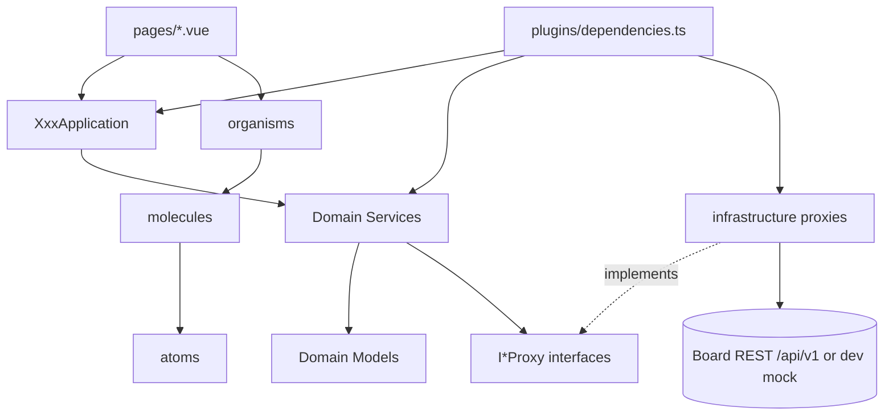

# Trading Board Web — Architecture Design

**Status:** Confirmed (unattended run)
**Source PRD:** `.sdd/2026-11-25-trading-board-web/PRD.md`
**Tech context:** Nuxt 3 (SPA, `ssr: false`, `nuxt generate` → nginx) · Bun · TypeScript strict ·
Clean/Onion layering per `frontend/.claude/rules` (Controller `.vue` → Application → Domain ← Infrastructure Proxy) ·
SCSS tokens · Vitest + @vue/test-utils · mirrors `go-trading-frontend`.

---

## 1. Design Goal & Guiding Principle

- **In one sentence:** a static SPA that talks to the board's REST API (contract §4) through
  one Proxy per resource, turns wire JSON into entities, lets Domain Models decide every
  business display rule (order progress, expiry, colours, budget bar, win rate), and hands
  the Vue components nothing but ready-to-render DTOs.
- **Guiding principle:** *components never decide anything.* Each order DTO carries its own
  label/value detail rows, status label + tone, and whether actions are allowed, so a single
  `OrderCard` renders both buy and sell orders, and new order fields or statuses are a
  Domain-Model change only. The API base URL is the single config surface that switches
  between the dev mock (Nitro server routes, network level) and the real board.

---

## 2. Change Scope

| Area | Action | What / Why |
| :--- | :--- | :--- |
| `frontend/` project skeleton | **Add** | package.json (bun), nuxt.config.ts, eslint/stylelint/vitest configs, husky, Dockerfile, nginx.conf, .env.example — copied from go-trading-frontend and trimmed |
| `app/assets/styles/` | **Add** | token / function / breakpoint / mixin layer (go-trading-frontend style) incl. `profit` (red) / `loss` (green) tokens |
| `app/domain/**` | **Add** | entities, domain models, DTO, VO, errors, proxy interfaces, domain services |
| `app/infrastructure/proxy/**` | **Add** | `BoardApiProxy` base + 5 resource proxies + `SessionStorageProxy` |
| `app/application/**` | **Add** | 4 Applications (session, trade card, position, month summary) |
| `app/components/**`, `app/pages/**`, `app/layouts/`, `app/middleware/` | **Add** | atomic components, 6 routes, auth guard |
| `server/routes/mock/api/v1/**` | **Add** | dev-only network-level mock of contract §4 (in-memory, seeded) — data-access.md allows a Nuxt server route as the pre-backend stand-in |
| `.github/workflows/frontend-ci.yml` (repo root) | **Add** | lint/test/build, push GHCR, bump deploy tag |
| go-trading-deploy `trading-board-frontend/` + argocd | **Add** | k8s manifests |
| i18n (vue-i18n) | **Not touched** | single locale (zh-TW) required; strings live in Domain Models / components directly |
| Live prices, unrealized P&L, fill edit/delete | **Not touched** | out of scope v1 |
| `backend/**` | **Not touched** | other agent |

---

## 3. New Classes / Modules

### Domain — entities (`app/domain/models/entities/`, fields only + `toDomain()` / `toDto()` shape conversions)

| Name | Responsibility | Satisfies |
| :--- | :--- | :--- |
| `Session` | accessToken + expiresAt; `toDomain()` → `SessionDomain` | US-01 |
| `TradeCard` | tradeDate, status, note, buyOrders, sellOrders, publishedAt; `toDomain(today)` | US-02, US-04, US-06 |
| `BuyOrder` / `SellOrder` | contract order fields (Decimal money) + status, filledShares, fills; `toDto(progressVo)` | US-02 |
| `Fill` | price, shares, fee, amount, filledAt; `toDto()` | US-03 |
| `TradeCardSummary` | one month-list row; `toDto()` | US-06 |
| `Position` | open/closed position fields; `toDomain()` | US-07 |
| `MonthSummary` | budget (§3.6) + performance (§3.7) fields; `toDomain()` | US-05, US-08 |

### Domain — domain models (`models/domains/`, where business rules live)

| Name | Responsibility | Satisfies |
| :--- | :--- | :--- |
| `SessionDomain` | is the session still usable at `now` | US-01 expired sign-in |
| `TradeCardDomain` | build `TradeCardDto` (no-trade banner, sections, empty-sell text) using `OrderProgressDomain` per order | US-02, US-04, US-06 |
| `OrderProgressDomain` | from status / shares / filledShares / session-is-past → display status (待成交/部分成交/已成交/已略過/已過期), tone, remaining shares, actionable | US-04 |
| `FillDraftDomain` | validate the fill form (price > 0, integer shares 1..remaining, fee empty or ≥ 0, filledAt present) → error message or `FillRequestVo` | US-03 |
| `PositionDomain` | open-position DTO; closed-position DTO with 獲利/虧損 label and profit/loss/neutral tone | US-07 |
| `MonthSummaryDomain` | budget strip DTO (remaining/allocation text, bar % = remaining ÷ (allocation+carried+recycled) clamped 0–100, mode label/tone) and summary DTO (breakdown, win rate = wins ÷ closed, return %, 「—」 when none closed) | US-05, US-08 |
| `TaipeiCalendarDomain` | today / current month in Asia/Taipei; `MonthDto` (label, previous, next or null if future) | US-04 expiry, US-06/07/08 month pickers |

### Domain — DTO / VO / errors / interfaces / services

| Name | Kind | Responsibility |
| :--- | :--- | :--- |
| `CredentialsDto`, `FillReportDto`, `OrderActionDto` | DTO (input) | component → application inputs |
| `TradeCardDto`, `OrderDto`, `DetailRowDto`, `FillDto`, `TradeCardSummaryDto`, `MonthlyCardListDto`, `OpenPositionDto`, `ClosedPositionDto`, `ClosedPositionListDto`, `BudgetStripDto`, `MonthSummaryDto`, `MonthSummaryPageDto`, `MonthDto` | DTO (output) | ready-to-render shapes; tones are finite unions |
| `OrderProgressVo`, `FillRequestVo` | VO | progress result; validated fill payload (Decimal) |
| `SignedOutError`, `CredentialsRejectedError`, `BoardRejectedError(message)`, `BoardUnreachableError`, `FillDraftInvalidError(message)` | sentinel errors | components branch error screens |
| `IAuthProxy`, `ISessionStorageProxy`, `ITradeCardProxy`, `IOrderProxy`, `IPositionProxy`, `IMonthSummaryProxy` | interfaces | one per resource |
| `UserSessionService` | Domain Service | sign in (proxy → store), is signed in, sign out |
| `TradeCardService` | Domain Service | latest card / card by date / month list; report fill & skip (validate → proxy → re-read card) |
| `PositionService` | Domain Service | open list; closed list for month (+ MonthDto) |
| `MonthSummaryService` | Domain Service | budget strip for current month; summary page for month (404 → null) |

### Infrastructure (`app/infrastructure/proxy/`)

| Name | Responsibility |
| :--- | :--- |
| `BoardApiProxy` (abstract) | `$fetch` with base URL + `Authorization: Bearer`; translate failures: 401 → `SignedOutError` (+ `onSignedOut` hook), other 4xx → `BoardRejectedError(error.message)`, no response / 5xx → `BoardUnreachableError` |
| `AuthProxy` | `POST /auth/login`; 401 → `CredentialsRejectedError` |
| `SessionStorageProxy` | localStorage read/write/clear of the session (never throws) |
| `TradeCardProxy` | `GET /cards/latest` (404 → null), `GET /cards/{d}`, `GET /cards?month=` |
| `OrderProxy` | `POST /orders/{id}/fills`, `POST /orders/{id}/skip` |
| `PositionProxy` | `GET /positions?status=open`, `GET /positions?status=closed&month=` |
| `MonthSummaryProxy` | `GET /months/{m}/summary` (404 → null) |
| `trade-card-wire.ts` | shared wire → entity readers for card/order/fill (used by TradeCardProxy; OrderProxy needs none since it re-reads) |

### Application (`app/application/`)

`UserSessionApplication`, `TradeCardApplication`, `PositionApplication`, `MonthSummaryApplication` — thin, DTO in / DTO out.

### Controller (`app/pages`, `app/components`, `app/layouts`, `app/middleware`, `app/composables`)

| Name | Layer | Responsibility |
| :--- | :--- | :--- |
| `AppButton`, `AppBadge`, `AppInput`, `AppAlert`, `AppSpinner`, `AppProgressBar` | atoms | generic UI, variants via finite unions |
| `MonthStepper` | molecule | ‹ 2026年11月 › driven by `MonthDto` |
| `BudgetStrip` | molecule | renders `BudgetStripDto` |
| `FillReportForm` | molecule | form with defaults from `OrderDto`; emits `submit(FillReportDto)` / `cancel` |
| `LoginForm` | organism | credentials → emits submit; shows error |
| `OrderCard` | organism | one order (buy or sell) — detail rows, status, fills, 回報成交/略過 |
| `TradeCardView` | organism | no-trade banner or 買進/賣出 sections of `OrderCard`; forwards actions |
| `CardSummaryList` | organism | month list rows linking to detail |
| `OpenPositionList`, `ClosedPositionList` | organism | positions with tone colouring |
| `MonthSummaryPanel` | organism | breakdown + performance |
| `AppShell` | template | header + nav (今日/歷史/持股/月報) + 登出 slot + content slot |
| `use-async-view` composable | composable | loading/error/data state + retry for a page load (shared by every page) |
| `auth.global.ts` | middleware | unsigned → `/login`; signed-in on `/login` → `/` |
| pages | page | `/login`, `/` (Today), `/history`, `/history/[tradeDate]`, `/positions`, `/summary` |

### Mock (`server/routes/mock/api/v1/**`, dev only)

Nitro handlers implementing contract §4 against an in-memory store seeded with a trade card
(聯電 buy, 晶豪科 sell + an open 晶豪科 position), with fills, skip, budget, positions and the
fee formula. Credentials `owner` / `owner`. Active when `NUXT_PUBLIC_API_BASE_URL=/mock/api/v1`
(the dev default); production images bake the real URL.

---

## 4. Modified Components

None — greenfield frontend.

---

## 5. Component Relationships

---

## 6. Extensibility & Handoff Notes

- **Most likely next requirement:** more order fields or statuses (e.g. "cancelled"),
  fill correction (edit/delete), unrealized P&L once a price feed exists.
- **Where it lands:** `OrderProgressDomain` (status → label/tone/actionable) and the
  entity's `toDto()` detail rows; `OrderCard` renders whatever rows/actions the DTO carries.
  Fill correction is a new `IOrderProxy` method + `TradeCardService` use case + one more
  action on `OrderDto`.
- **How to add it:** add a case to the status map / detail rows; no component edits for
  new display fields.
- **Patterns applied & why:** Proxy per resource (contract churn stays in one file);
  shared `BoardApiProxy` error translation (one rule for 401/4xx/unreachable); DTO-driven
  generic `OrderCard` (buy/sell asymmetry lives in Domain).
- **Do not hardcode:** API base URL (runtime config / build arg); colours (tokens);
  Taipei timezone constant lives only in `TaipeiCalendarDomain`.
- **Known debt / deferred:** after a fill/skip the service re-reads the whole card rather
  than patching one order (the contract's "updated order" response doesn't say whether it is
  buy or sell; one extra GET is cheap). Revisit if the card grows large.

---

## 7. Traceability

| PRD Scenario | Fulfilled by |
| :--- | :--- |
| US-01 Correct credentials open Today | `LoginForm` → `UserSessionApplication.signIn` → `UserSessionService` → `AuthProxy` + `SessionStorageProxy`; login page navigates `/` |
| US-01 Wrong password is refused | `AuthProxy` 401 → `CredentialsRejectedError` → login page shows 「帳號或密碼錯誤」 |
| US-01 A protected screen without signing in leads to sign-in | `auth.global.ts` + `UserSessionApplication.isSignedIn` |
| US-01 An expired sign-in leads back to sign-in | `SessionDomain` expiry check; `BoardApiProxy` 401 → `onSignedOut` hook clears session + navigate `/login` |
| US-01 Signing out | `AppShell` 登出 → `UserSessionApplication.signOut` → `SessionStorageProxy.clear` |
| US-02 A trade card shows buy and sell sections | `TradeCardDomain` + `BuyOrder/SellOrder.toDto` detail rows → `TradeCardView` / `OrderCard` |
| US-02 A trade card without sells | `TradeCardDomain` empty-section text 「無賣出委託」 |
| US-02 A month-end allocation buy is marked | `BuyOrder.toDto` tag 「月底配置」 |
| US-02 A no-trade card | `TradeCardDomain` (`isNoTrade`, note) → `TradeCardView` banner |
| US-02 No card has been published yet | `TradeCardProxy` 404 → null → `TradeCardService` → Today empty state |
| US-03 Form starts at the order's limit price and all shares | `OrderDto.defaultFillPrice/remainingShares` → `FillReportForm` |
| US-03 Form starts at the remaining shares | `OrderProgressDomain.remainingShares` |
| US-03 Filling exactly the remaining shares is accepted | `FillDraftDomain` boundary; `TradeCardService.reportFill` re-reads card |
| US-03 More than the remaining shares is refused by the form | `FillDraftDomain` → `FillDraftInvalidError` 「股數不可超過剩餘 N 股」 |
| US-03 Zero shares or zero price is refused by the form | `FillDraftDomain` messages |
| US-03 The board refuses a fill that exceeds the month's budget | `BoardApiProxy` 4xx → `BoardRejectedError(message)` → `OrderCard` error; card not replaced |
| US-03 Leaving the fee empty lets the board estimate it | `FillRequestVo.fee` undefined → `OrderProxy` omits `fee`; `Fill.toDto` shows returned fee |
| US-03 Reporting refreshes the budget strip | Today page reloads `MonthSummaryApplication.fetchBudgetStrip` after a fill |
| US-04 Waiting order of today's session | `OrderProgressDomain` |
| US-04 Partly bought order | `OrderProgressDomain` |
| US-04 Fully bought order | `OrderProgressDomain` |
| US-04 Skipping an order | `TradeCardService.skipOrder` → `OrderProxy.skipOrder` → re-read; `OrderProgressDomain` skipped |
| US-04 Waiting order of a past session is expired | `OrderProgressDomain` + `TaipeiCalendarDomain.today` |
| US-04 Partly bought order of a past session stays reportable | `OrderProgressDomain` (expired only when nothing filled) |
| US-05 Ordinary day in the strict window | `MonthSummaryDomain.toBudgetStripDto` → `BudgetStrip` |
| US-05 Month-end window | `MonthSummaryDomain` mode label |
| US-05 Everything spent | `MonthSummaryDomain` bar clamp |
| US-05 Carried over and recycled money | `MonthSummaryDomain` bar clamp to 100 |
| US-06 Current month is shown first | `TaipeiCalendarDomain` → `TradeCardService.listCards` → `MonthlyCardListDto` → `CardSummaryList` |
| US-06 Month without cards | `CardSummaryList` empty text |
| US-06 Opening a past card | `/history/[tradeDate]` → `TradeCardService.fetchCard` → same `TradeCardView`; `OrderProgressDomain` expiry |
| US-07 Open positions | `PositionService.listOpenPositions` → `PositionDomain` → `OpenPositionList` |
| US-07 A profitable closed position | `PositionDomain` tone `profit` → `ClosedPositionList` |
| US-07 A losing closed position | `PositionDomain` tone `loss` |
| US-07 A break-even closed position | `PositionDomain` tone `neutral`, label 虧損 |
| US-07 Nothing held | `OpenPositionList` empty text |
| US-08 Budget breakdown and performance | `MonthSummaryService.fetchMonthSummary` → `MonthSummaryDomain.toDto` → `MonthSummaryPanel` |
| US-08 No closed positions | `MonthSummaryDomain` 「—」 |
| US-08 Month before the board's first month | `MonthSummaryProxy` 404 → null → `MonthSummaryPageDto.summary = null` → 「這個月沒有資料」 |
| US-09 Sample data preview | `server/routes/mock/api/v1/**` + `apiBaseUrl` default |
| US-09 Switching to the live board | `runtimeConfig.public.apiBaseUrl` (`NUXT_PUBLIC_API_BASE_URL` build arg) |

---

## 8. Risks & Open Decisions

- **Risks / trade-offs:** positions and month-summary response shapes are not fixed by
  contract §4 → assumed (below) and filed in
  `docs/contract-change-requests/frontend.md`. The proxies are the only place to change if
  the backend picks other names.
  - Assumed positions item: `{ symbol, name, status, shares, averageCost, totalCost,
    stopLossPrice, takeProfitPrice, openedDate, closedDate, daysHeld, realizedPnl }`,
    response a bare JSON array.
  - Assumed summary: flat `{ month, allocation, carriedOver, recycledProceeds, spent,
    remaining, mode, realizedPnl, closedPositionCount, winCount, lossCount, winRate,
    realizedReturnPct }`; the web computes win rate itself from counts; `realizedReturnPct`
    is a percentage decimal string or null.
  - Card list response: bare JSON array.
- **API base URL is baked at build time** (as in go-trading-frontend): changing it needs a
  rebuild; no ConfigMap.
- **Open decisions (for implementation):** none blocking.
