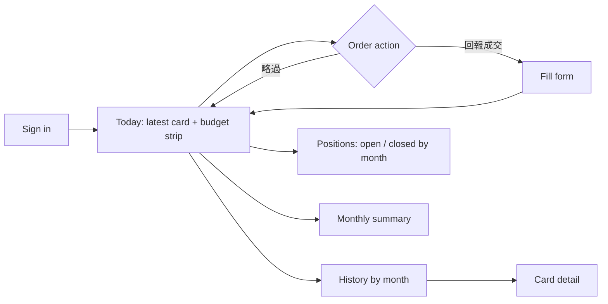

# Product Requirements Document (PRD) — Trading Board Web

**Status:** Finalized (unattended run; decisions from stakeholder requirements v1)
**Version:** v1.0
**Owner:** Trading Board owner
**Stakeholders:** Owner (sole user), agent team (publishes cards), board service team

---

## 1. Background & Goal (Why & Goal)

- **Problem Statement:** Every evening the agent team publishes a Daily Trade Card. The
  owner needs one place, mostly on a phone, to read the card, place the orders at the
  broker, report what actually filled, and see what those fills mean for positions, the
  month's budget and the month's realized result.
- **Expected Outcome:** The owner can go from opening the site to having reported every
  fill of the day in under a minute per order, and can answer "how much budget is left
  this month?" and "how did this month go?" from a single screen each.
- **Out of Scope:** live prices and unrealized profit/loss; editing or deleting a reported
  fill (a wrong fill stays — known limitation); publishing cards from the web;
  notifications; multiple users, sign-up, password change; languages other than
  Traditional Chinese.

---

## 2. User Personas

- **Primary Role(s):** Owner — the single person who trades the agent team's
  recommendations.
- **Usage Context:** Evening (reading the new card) and during the trading session or
  just after (reporting fills), mostly on a phone; occasionally on a desktop for
  history and monthly review. Language: Traditional Chinese. Colour convention: red =
  profit / up, green = loss / down.

---

## 3. User Stories & Acceptance Criteria

### US-01 — Sign in [priority: P0]
**As the** owner, **I want** to sign in once with my username and password, **so that**
only I can see and change my trading records.

```gherkin
Scenario: Correct credentials open Today
  Given the owner is not signed in
  When the owner signs in with the correct username and password
  Then the owner sees the Today screen

Scenario: Wrong password is refused
  Given the owner is not signed in
  When the owner signs in with a wrong password
  Then the owner stays on the sign-in screen
  And sees 「帳號或密碼錯誤」

Scenario: A protected screen without signing in leads to sign-in
  Given the owner is not signed in
  When the owner opens the History screen directly
  Then the owner is taken to the sign-in screen

Scenario: An expired sign-in leads back to sign-in
  Given the owner signed in earlier and that sign-in is no longer accepted
  When the owner opens any screen or performs any action
  Then the owner is taken to the sign-in screen

Scenario: Signing out
  Given the owner is signed in
  When the owner taps 登出
  Then the owner is taken to the sign-in screen
  And opening Today again leads to the sign-in screen
```

### US-02 — Read tonight's card [priority: P0]
**As the** owner, **I want** to see the latest Daily Trade Card with every order detail,
**so that** I can place exactly those orders at the broker.

```gherkin
Scenario: A trade card shows buy and sell sections
  Given the latest card is for 2026-11-26 with a buy order for 聯電 2303 and a sell order for 晶豪科 3006
  When the owner opens Today
  Then the 買進 section shows the 聯電 order with limit price, maximum chase price, shares, estimated amount, stop loss, take profit, reason and status
  And the 賣出 section shows the 晶豪科 order with limit price, shares, exit reason, reason and status

Scenario: A trade card without sells
  Given the latest card has buy orders but no sell orders
  When the owner opens Today
  Then the 賣出 section shows 「無賣出委託」

Scenario: A month-end allocation buy is marked
  Given the latest card has a buy order placed as a month-end allocation
  When the owner opens Today
  Then that order is marked 「月底配置」

Scenario: A no-trade card
  Given the latest card is a no-trade card with the note 「大盤轉弱」
  When the owner opens Today
  Then the owner sees the 「今日不買」 banner with 「大盤轉弱」
  And no order sections are shown

Scenario: No card has been published yet
  Given no card has ever been published
  When the owner opens Today
  Then the owner sees 「尚未發布任何交易卡」
```

### US-03 — Report a fill [priority: P0]
**As the** owner, **I want** to report what actually filled at the broker, **so that**
positions, budget and results stay true.

```gherkin
Scenario: Form starts at the order's limit price and all shares
  Given a buy order of 90 shares at limit price 52.5 with nothing filled
  When the owner opens 回報成交 for it
  Then the price shows 52.5, the shares show 90 and the fee is empty

Scenario: Form starts at the remaining shares
  Given a buy order of 90 shares with 60 already filled
  When the owner opens 回報成交 for it
  Then the shares show 30

Scenario: Filling exactly the remaining shares is accepted
  Given an order with 30 shares remaining
  When the owner reports a fill of 30 shares at a positive price
  Then the order shows 「已成交」 with the new fill listed

Scenario: More than the remaining shares is refused by the form
  Given an order with 30 shares remaining
  When the owner enters 31 shares
  Then the form refuses with 「股數不可超過剩餘 30 股」
  And nothing is reported

Scenario: Zero shares or zero price is refused by the form
  Given an order with shares remaining
  When the owner enters 0 shares or a price of 0
  Then the form refuses with 「股數須為 1 以上的整數」 or 「價格須大於 0」

Scenario: The board refuses a fill that exceeds the month's budget
  Given this month's remaining budget is NT$1,000
  When the owner reports a buy fill costing NT$4,725
  Then the owner sees the board's reason for refusing
  And the order keeps its previous status and filled shares

Scenario: Leaving the fee empty lets the board estimate it
  Given the owner leaves the fee empty
  When the owner reports a valid fill
  Then the new fill is listed with the fee the board estimated

Scenario: Reporting refreshes the budget strip
  Given the remaining budget shows NT$10,000
  When the owner reports a buy fill costing NT$4,732
  Then the budget strip shows the new remaining amount the board reports
```

### US-04 — Skip an order and see order progress [priority: P0]
**As the** owner, **I want** to mark an order I did not place, and to see each order's
progress at a glance, **so that** I know what is still open.

```gherkin
Scenario: Waiting order of today's session
  Given an order for today's session with nothing bought yet
  When the owner looks at it
  Then it shows 「待成交」 and offers 回報成交 and 略過

Scenario: Partly bought order
  Given an order with 30 of 90 shares bought
  When the owner looks at it
  Then it shows 「部分成交」 and offers 回報成交 and 略過

Scenario: Fully bought order
  Given an order with all 90 of 90 shares bought
  When the owner looks at it
  Then it shows 「已成交」 and offers no actions

Scenario: Skipping an order
  Given a waiting order
  When the owner taps 略過
  Then it shows 「已略過」 and offers no actions

Scenario: Waiting order of a past session is expired
  Given an order for yesterday's session with nothing bought
  When the owner looks at it
  Then it shows 「已過期」 and offers no actions

Scenario: Partly bought order of a past session stays reportable
  Given an order for yesterday's session with 30 of 90 shares bought
  When the owner looks at it
  Then it shows 「部分成交」 and still offers 回報成交
```

### US-05 — Month budget strip [priority: P0]
**As the** owner, **I want** to see how much of this month's money is left on Today,
**so that** I can deploy the full monthly budget.

```gherkin
Scenario: Ordinary day in the strict window
  Given allocation NT$10,000, nothing carried over, nothing recycled, NT$4,725 spent, and the board reports the strict window
  When the owner opens Today
  Then the strip shows 「剩餘 NT$5,275 / 月配額 NT$10,000」
  And the bar is 52.75 % full
  And the badge reads 「嚴格期」

Scenario: Month-end window
  Given the board reports the month-end window
  When the owner opens Today
  Then the badge reads 「月底配置期」

Scenario: Everything spent
  Given remaining is NT$0
  When the owner opens Today
  Then the strip shows 「剩餘 NT$0」 and the bar is empty

Scenario: Carried over and recycled money
  Given allocation NT$10,000, NT$2,000 carried over, NT$3,000 recycled and nothing spent
  When the owner opens Today
  Then the strip shows 「剩餘 NT$15,000 / 月配額 NT$10,000」 and the bar is full
```

### US-06 — History [priority: P1]
**As the** owner, **I want** to browse earlier cards by month, **so that** I can review
what the team recommended and what I did.

```gherkin
Scenario: Current month is shown first
  Given today is 25 November 2026 in Taiwan
  When the owner opens History
  Then November 2026 is selected and its cards are listed newest first
  And each row shows the trade date, 交易 or 今日不買, the number of buys and sells and the number of completed orders

Scenario: Month without cards
  Given no card was published in November 2026
  When the owner chooses November 2026
  Then the owner sees 「這個月沒有交易卡」

Scenario: Opening a past card
  Given the list shows the card of 2026-11-20
  When the owner opens it
  Then the owner sees that card in the same layout as Today
  And its still-waiting orders show 「已過期」 without actions
```

### US-07 — Positions [priority: P1]
**As the** owner, **I want** to see my open positions and the positions I closed in a
month, **so that** I know what I hold and what I made.

```gherkin
Scenario: Open positions
  Given the owner holds 90 shares of 聯電 at average cost 52.58
  When the owner opens Positions
  Then 聯電 is listed with shares 90, average cost 52.58, total cost, stop loss, take profit, opened date and days held

Scenario: A profitable closed position
  Given a position closed this month with realized profit/loss +1,200
  When the owner views closed positions for this month
  Then it is shown in red, labelled 「獲利」

Scenario: A losing closed position
  Given a position closed this month with realized profit/loss −800
  When the owner views closed positions for this month
  Then it is shown in green, labelled 「虧損」

Scenario: A break-even closed position
  Given a position closed this month with realized profit/loss 0
  When the owner views closed positions for this month
  Then it is shown in a neutral colour, labelled 「虧損」

Scenario: Nothing held
  Given the owner holds nothing
  When the owner opens Positions
  Then the open list shows 「目前沒有持股」
```

### US-08 — Monthly summary [priority: P1]
**As the** owner, **I want** a month's budget breakdown and realized performance,
**so that** I can judge the month.

```gherkin
Scenario: Budget breakdown and performance
  Given November 2026 has allocation NT$10,000, carried over NT$0, recycled NT$3,300, spent NT$9,800, and 3 closed positions with 2 wins
  When the owner opens the monthly summary for November 2026
  Then the owner sees allocation, carried over, recycled proceeds, spent, remaining and the window
  And realized profit/loss, 3 closed positions, 2 wins, 1 loss and win rate 66.67 %

Scenario: No closed positions
  Given a month with no closed positions
  When the owner opens its summary
  Then win rate and realized return show 「—」

Scenario: Month before the board's first month
  Given the board has no records for October 2026
  When the owner opens the summary for October 2026
  Then the owner sees 「這個月沒有資料」
```

### US-09 — Preview with sample data [priority: P1]
**As the** owner, **I want** to try the whole site with sample data before the board
service is live, **so that** the web can be reviewed early; switching to the live board
must be a setting change.

```gherkin
Scenario: Sample data preview
  Given the site is set to use sample data
  When the owner signs in with the sample credentials
  Then Today shows the sample card for the next session with its 聯電 buy order and 晶豪科 sell order
  And reporting a fill on the 聯電 order changes it to 「部分成交」 or 「已成交」 and lowers the remaining budget

Scenario: Switching to the live board
  Given the site is set to use the live board
  When the owner signs in
  Then all cards, fills, positions and summaries come from the live board
```

---

## 4. Business Flow & Logic



- **Core Business Rules:**
  - Displayed order state: skipped → 已略過; filled shares = shares → 已成交; filled
    shares > 0 → 部分成交; nothing filled and the trade date is before today (Taipei)
    → 已過期; otherwise 待成交.
  - Actions offered only for 待成交 and 部分成交.
  - Fill form: price > 0; shares a whole number from 1 to the remaining shares; fee
    empty or ≥ 0; fill time required (defaults to now).
  - Budget bar = remaining ÷ (allocation + carried over + recycled proceeds), between
    0 % and 100 %; a zero denominator shows an empty bar.
  - Profit colouring: > 0 red (獲利), < 0 green (虧損), = 0 neutral (counts as 虧損).
  - Win rate and realized return shown as percentages with two decimals; 「—」 when
    there are no closed positions in the month.
  - Money is shown exactly as reported by the board, amounts prefixed NT$ with
    thousands separators; never recomputed with rounding drift.
  - "Today" and "this month" are Asia/Taipei.
- **Edge Cases:**
  - The board cannot be reached → a 「無法連線，請稍後再試」 message with a retry.
  - The board refuses an action (conflict, validation) → its message is shown next to
    the action; the order is left as it was.
  - The sign-in stops being accepted mid-session → back to sign-in.
  - Double-tap on submit → only one report is sent (the button is disabled while
    sending).

---

## 5. UI/UX Design & Interaction

- **Prototype Link:** N/A — follows go-trading-frontend's visual language.
- **Key Interactions:**
  - Mobile-first single column; bottom/top navigation: 今日 / 歷史 / 持股 / 月報.
  - Order cards stack vertically; on wide screens two columns.
  - 回報成交 opens an inline form inside the order card; 送出 / 取消.
  - Empty states as listed in the scenarios; loading shows a spinner; errors show a
    message with 重試.

---

## 6. Non-Functional Requirements

- **Performance:** Today renders within 2 s on a mid-range phone over 4G.
- **Security:** Only the signed-in owner can view anything; the sign-in is kept only in
  this browser and cleared on sign-out.
- **Compatibility:** Latest two versions of mobile Safari and Chrome; desktop Chrome.
- **Analytics / Tracking:** N/A.

---

## 7. Dependencies & Risks

- **External Dependencies:** The board service (built in parallel) and its shared
  agreement (requirements §4).
- **Known Risks:**
  - The shapes of the positions list and the monthly summary are not spelled out in the
    shared agreement — assumption recorded and raised as a change request (A1).
  - A wrong fill cannot be corrected from the web in v1.

## 8. Appendix

- Stakeholder requirements: `docs/requirements/trading-board.md`
- Brief: `.sdd/2026-11-25-trading-board-web/BRIEF.md` (assumptions A1–A6)
